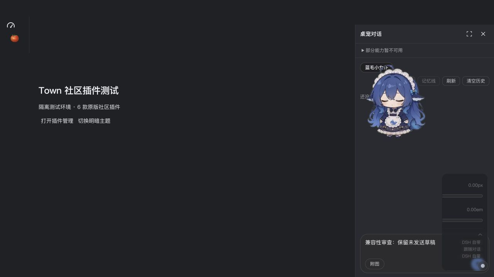
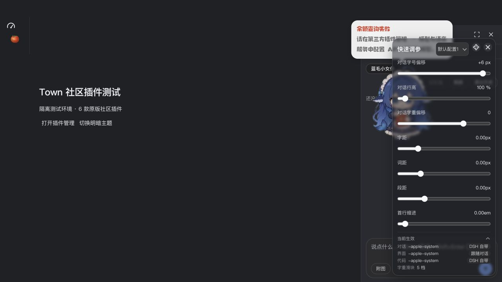
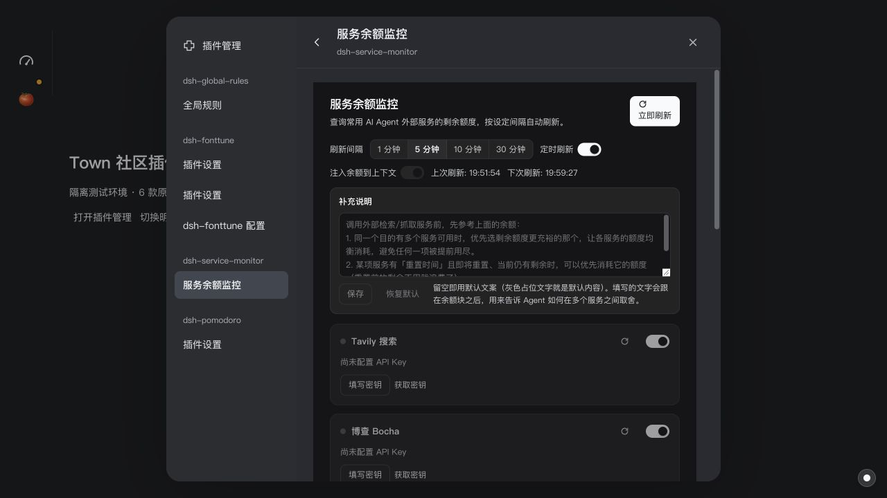
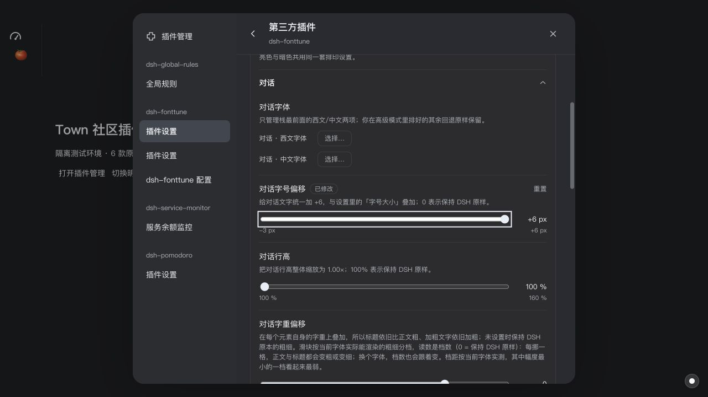
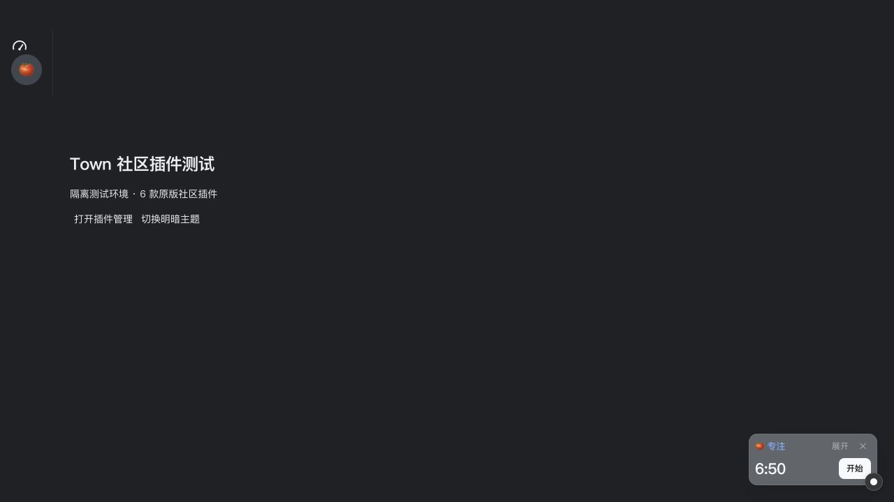

# Town DSH 插件兼容性复核（2026-11-04）

结论：当前已有通用插件加载、配置、HTTP/Remote、基础界面和模型服务子集，但不能据此认定“大部分社区插件完整兼容”。本轮新抽样 6 款，4 款能加载并完成部分交互，2 款被明确阻止；加载成功的样本仍存在未接通的核心功能。另用原版 dsh-pet 复现了侧栏生命周期问题。本轮只做审查、测试和记录，没有修改生产实现。

## 范围与方法

- 参考 [DSH Open 插件目录](https://dshopen.org/zh/)和相应插件说明；上游代码对照基线为 DSH 0.2.1-rc.5。目录条目和版本校验不是运行兼容性证明。
- 从 npm 获取固定版本的原版包，不修改插件代码，使用独立的安装目录和 DSH_HOME。6 款抽样同时安装，以覆盖共同运行和生命周期。
- 实际编译当前工作区的 DshPluginManager、worker、DshClientRuntime、DshPluginSurfaces 和样式，用测试桥接挂到最小页面壳；使用 computer use 操作页面。宿主及插件真实运行，页面壳不是完整 Town Electron/Being 聊天界面。
- 未配置任何真实服务密钥，没有进行付费模型、付费搜索、真实余额或麦克风测试。
- Mac 仍处于锁屏状态，computer use 无法访问 Harness 原生窗口。本轮不包含独立透明窗口、托盘、桌面拖拽、窗口层级或 Harness 与 Town 的原生视觉等价验收。此前为对照而停用的 Harness 桌宠，仍需在解锁后恢复。

## 发现的问题

### P1：停用无关插件会关闭有效的新式侧栏，导致草稿丢失

位置：`desktop/renderer/plugins/dsh/runtime.tsx:195`，与新增 `interactions.ts:41–45` 的 `sidebarRight.openTab` 交互。

复现：同时加载 dsh-pet 0.4.1 和 dsh-global-rules 0.2.2；打开“桌宠对话”，输入未发送草稿；进入插件管理，停用全局规则。桌宠仍显示已加载，但其侧栏关闭，重新打开后草稿为空。

原因：`reconcile()` 只检查旧 `rightbar` 插槽是否存在。新增服务使用 `sidebar.right.pane.tab`，因此任何触发对账的插件操作都会命中关闭条件，即使当前标签仍有效。应按当前侧栏模式及当前标签的存活状态决定是否关闭，并增加“操作无关插件时保留侧栏和草稿”的回归。

### P2：缺失的可选宿主能力没有显示为限制

位置：`desktop/main/plugins/dsh/worker.ts:157–163`。

当前限制信息只从顶层 `fiber.inject` 及少数模型回退服务生成。dsh-service-monitor 1.0.7 顶层只依赖 webServer，内部通过 `ctx.inject(['systemPrompt'], ...)` 可选注册提示词段落。Town 没有该服务，但管理页显示“已加载”、`limitations: []`，设置中的“注入余额到上下文”可正常开启，没有兼容提示。插件自己的实现会在缺服务时静默跳过。

这是部分兼容的状态报告缺口，不能通过伪造 systemPrompt 空服务解决。应向用户暴露未满足的可选服务或对应能力限制；真正的 Prompt 桥接需连接 Being 的执行协议。

全局规则也有类似语义缺口：它可以保存 `$DSH_HOME/AGENTS.md`，但 Town 当前的 Being 聊天链路没有读取/传递该文件的代码。插件原有“保存后实时生效”的说明在 Town 中不能当作验证结论。没有要求为这些包添加按包名判断的补丁。

### P2：模型适配丢失 finish 和 usage 事件

位置：`desktop/main/plugins/dsh/model-services.ts:72–78`；SDK 对应 `plugins/sdk/dsh.d.ts` 的 llm.stream 返回类型。

用本地构造的 OpenAI-compatible SSE，分别返回 `finish_reason: stop / length / content_filter` 和 usage，再将 Town 输出送入真实发布的 DSH BlockAssembler。三者都只得到 text-delta，Assembler 最终均为 `{kind:'stop'}`，usage 为空。真实长度截断会被消费方误认为正常结束，消费统计也缺失。

应按 DSH StreamChunk 语义转换结束原因和用量，并更新 SDK 类型及回归用例。这个问题不依赖真实 API 密钥；本轮原有模型单测虽然通过，但只检查了内容、UTF-8 和取消，未覆盖终止语义。

### P3：新设置导航重复显示兼容入口，标题也丢失

位置：`desktop/renderer/plugins/dsh/page.tsx:115–128`。

原版 dsh-fonttune 0.7.6 同时注册旧 `settings.plugin.item` 与新 `plugins.bundle.config`，用于兼容两代宿主设置入口。Town 把两者全部列入新导航，产生两个同名“插件设置”，又加一个自动配置页；打开原版页面后标题仍为“第三方插件”。dsh-pomodoro 的自定义设置入口同样缺少可辨识标题。

整体分区导航、固定页头和内容滚动可用，但应按上游插槽各自适用的宿主和安装类型处理这两种入口，避免同时呈现兼容注册，并为 keyed 设置组件提供稳定、可辨识的标题。不要按插件名去重，否则会掩盖真正的多个设置页。

## 原版插件抽样结果

| 插件 | 版本 | 实测结果及边界 |
| --- | --- | --- |
| [番茄钟](https://dshopen.org/zh/plugins/dsh-pomodoro/) | 0.5.5 | 能加载；专注时长 25→7 分钟，保存到 config-forms；主面板启动 7:00→6:50、暂停、迷你模式通过。没有等待完整周期，也未验证系统通知。 |
| [字体调校](https://dshopen.org/zh/plugins/dsh-fonttune/) | 0.7.6 | 能加载；原版设置、滑块、浮动调参面板可操作；对话字号 +6 保存，重载后仍为 +6。有重复导航。未验证其私有 DOM 选择器对真实 Being 聊天 iframe 的影响，不能判定对话字体功能完整通过。 |
| [服务余额监控](https://dshopen.org/zh/plugins/dsh-service-monitor/) | 1.0.7 | 能加载；8 个供应商卡片、无密钥状态、立即刷新、间隔 10→5 分钟及重载持久化通过。真实余额请求未测；上下文注入静默无效。 |
| [全局规则](https://dshopen.org/zh/plugins/dsh-global-rules/) | 0.2.2 | 能加载；编辑、保存、重载读取 AGENTS.md 通过。没有接入 Being 提示词，不能判定其主要语义已适配。 |
| [会话树](https://dshopen.org/zh/plugins/dsh-tree-view/) | 1.2.3 | 安装保留但自动停用；管理页准确列出缺少 sessions、agents、sessionPersistence、sessionQuery、workspaceRegistry。会话分支功能不可用。 |
| [TinyFish 搜索](https://dshopen.org/zh/plugins/dsh-tinyfish-search/) | 0.18.1 | prepare 阶段失败：`bundle 引用了不存在或不匹配的配置行：patch: entry %C not found web`。依赖 Harness 内置 web 配置行，未进入实际搜索测试。 |
| [桌宠（补充回归）](https://dshopen.org/zh/plugins/dsh-pet/) | 0.4.1 | 原版包成功加载，设置/对话侧栏可用；用于复现无关插件停用导致草稿丢失。仅测试进程设置 DSH_PET_IN_PROCESS=1，避免启动原生辅助程序；生产实现没有这一特判。本轮不计为原生透明窗口或模型聊天通过。 |

这些是有目的的功能抽样，不是随机统计样本。4/6 加载成功不能换算为生态兼容率。

## 本轮自动化验证

- `npm run test:dsh-contract`：5 个文件，39 个测试通过。
- `npm run test:dsh-lifecycle`：通过，含停启、卸载重装、更新、实例保留、加载失败和焦点定位；现有用例没有覆盖本报告的新式侧栏场景。
- `npx vitest run tests/plugin-sdk.test.ts`：25 个测试通过。
- `npm run typecheck`、`git diff --check`：通过。
- 额外模型协议复现：确认 length/content_filter 被误判为 stop，属于本轮发现而非通过项。

本轮没有重新运行完整仓库测试或原生 Electron 验收，不能把此前的全量结果记作本轮验证。

## 复现材料与后续范围

本机隔离目录：`/tmp/town-dsh-review-20261104/`。保留原版 `.tgz`、npm integrity (`pack.json`)、展开源码、隔离 profile、测试桥接 `serve.mjs`、最终状态 `final-state.json`、契约/lifecycle/SDK/typecheck 日志、`model-repro.mjs` 和其输出。`host-results.json` 的安装中途快照可能引用已重启宿主的旧状态，以最终状态和界面观察为准。测试代理曾因辅助流取消的未处理错误退出，修正仅限 `/tmp` 代理后重测；未把该夹具错误算作 Town 产品问题。

优先修复上述侧栏生命周期和状态报告，其次补全模型事件、设置入口契约。要扩大生态覆盖，还需通用的 Profile/configEditor 与配置树合并、Workspace/文件/终端服务，以及 Being 的 Session/Agent/Prompt/工具执行桥接；仅增加同名空接口无法提供原插件行为。已有兼容文档中明确列出的这些未支持域，本报告视为能力缺口，不一律视为本次新增回归。
