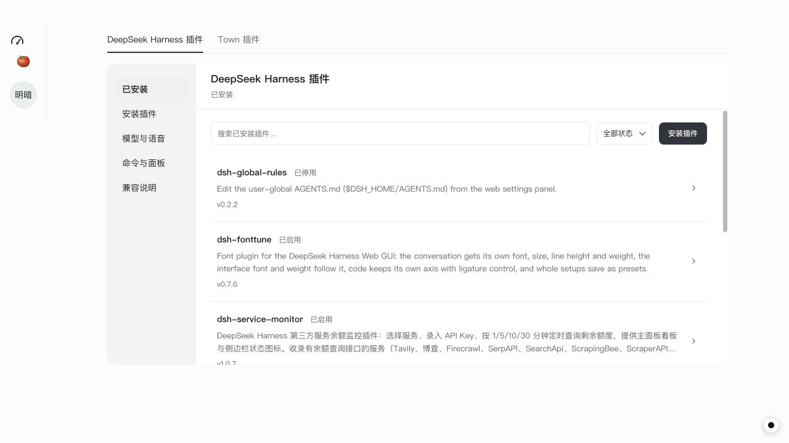
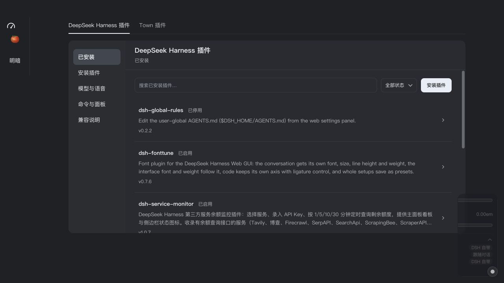
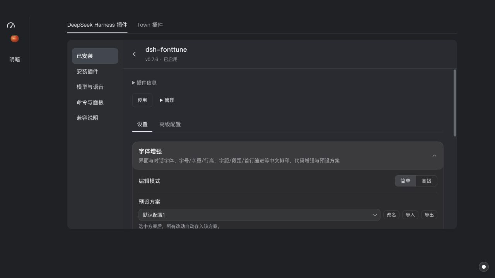
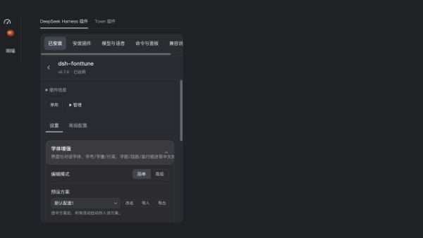

# DeepSeek Harness 插件管理优化

更新：2026-11-05 最终调整为「设置 → 插件」内嵌配置，官方插件在前；取消独立模型页，Being 优先、subagent 后备。见[最新验证记录](dsh-settings-subagent-2026-11-05.md)。下文保留 11-04 方案和当时测试记录，Kit 详情页与模型表单已被新方案取代。

2026-11-04。参考 DSH 0.2.1-rc.5 的 `PluginsSettingsSection` 及包配置入口，采用列表、单个插件详情和按任务分区的管理方式，保留 Town 的字体、颜色与控件。

## 页面与导航

- 产品入口统一为 **DeepSeek Harness 插件**。内部协议、目录和 DOM 标识不迁移，已安装插件与数据继续使用原位置。
- **工具库 → Plugin** 分成 **DeepSeek Harness 插件 / Town 插件**。前者直接在 Kit 内管理，无需再次弹出管理窗口；后者保留 Town SDK 插件的导入、打开和管理功能。原生 Town 插件返回管理时回到 Town 插件页，避免落入另一套插件体系。
- DSH 已安装列表只展示包名、状态、简短描述和版本；支持搜索和状态筛选。点击插件进入详情，返回列表保留搜索和筛选。
- 详情默认展示原版设置页；相同 key 的新 bundle 入口替代旧设置入口，自动生成的表单归入“高级配置”。更新与卸载在“管理”中，完整描述在“插件信息”中。
- 安装、模型与语音、命令与面板、兼容说明分区展示。模型服务草稿与自动配置表单在内部导航或关闭时提示未保存；DSH/Town 两个标签切换时保留已挂载的 DSH 表单。
- 客户端设置只保留一个 DSH 管理入口，不再列出所有插件的设置跳转。从此处进入仍使用同一管理界面的浮层；Kit 已有内嵌宿主时转到该页。
- Town 插件详情的权限、显示位置、图标和侧栏入口配置改为折叠展示，常用的页面入口保持直接可用。
- 面板标题和返回入口固定，内容独立滚动。浮层最大宽度 960px，侧导航 144px；内嵌窄容器使用横向导航。

同时修复 `sidebarRightTabs` 的生命周期判断：启停无关插件时，不再因没有旧式 `rightbar` 插槽而关闭有效的新式侧栏，保留其未发送草稿。`uiSettings.openSection` 也会清除之前的自动配置页，避免打开错误内容。

## 验证

- `npm test`：159 个文件通过、10 个跳过；1,350 项通过、33 项跳过。
- `npm run test:dsh-lifecycle`：现有生命周期用例通过，并新增列表返回保留筛选、新旧设置入口去重、模型配置未保存提示、无关插件启停保留侧栏草稿、内嵌管理保留原生 slot context 的回归。
- `npm run typecheck`、`npm run lint:styles`、`git diff --check` 通过。
- Vite renderer 生产构建通过；仍有既有的大 chunk 提示。
- Computer use：使用实际 ToolsLibrary、DshPluginSurfaces、worker 和原版社区包，在隔离 profile 验证列表→详情→返回、状态筛选、原版字体设置、新旧入口去重、桌宠停用、模型配置未保存提示、两类插件切换后保留 DSH 草稿。检查常规窗口的明暗主题和 600×800 窄窗口，确认内嵌管理有固定高度、独立滚动，管理内容区没有横向溢出。
- 本轮浏览器使用最小桌面壳，截图中的“明暗”是测试控件。真实 Electron 脚本已同步新入口与布局，但本轮未执行这些原生测试；Mac 锁屏，原生 Harness 对照和独立透明窗口仍未验收。

## 截图

未修复的宿主能力缺口仍见 [社区插件审查](dsh-community-review-2026-11-04.md)：可选 systemPrompt 服务的限制提示、Being 提示词桥接，以及模型流 finish/usage 语义。本轮集中整理管理界面与导航，没有把这些能力标成已支持。
