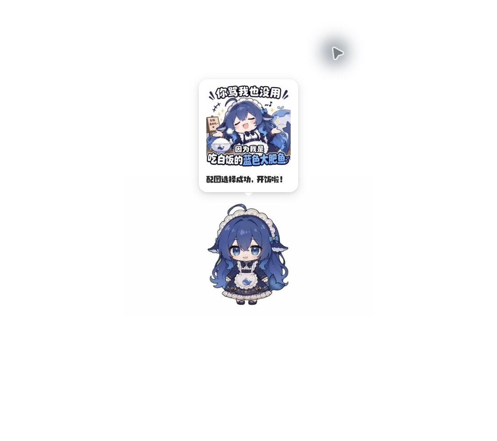
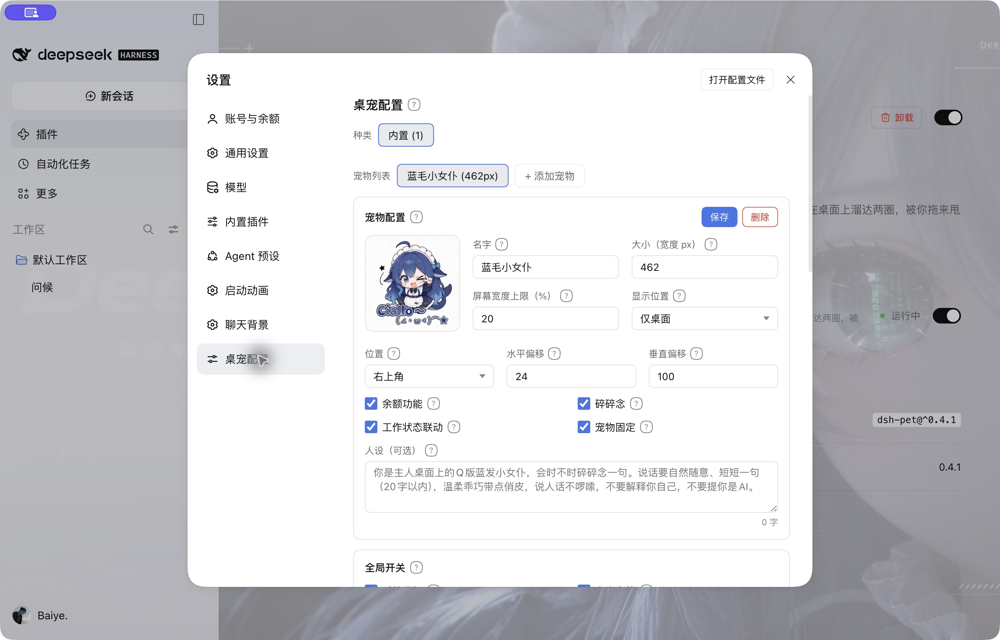
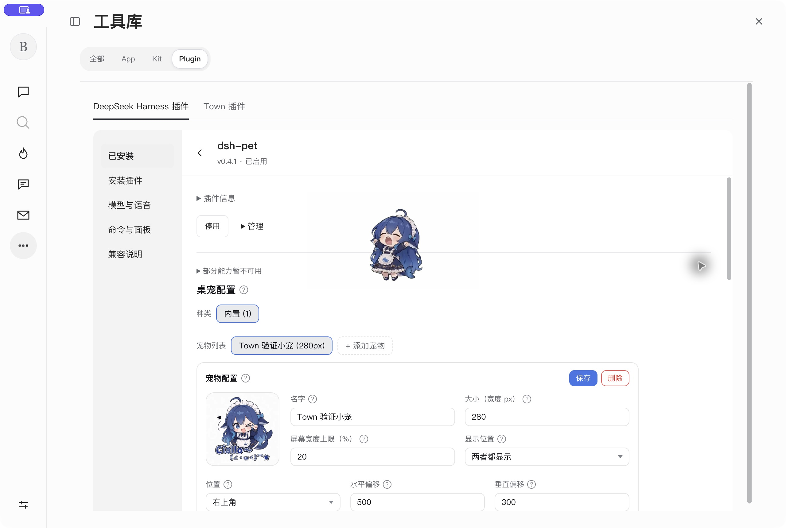
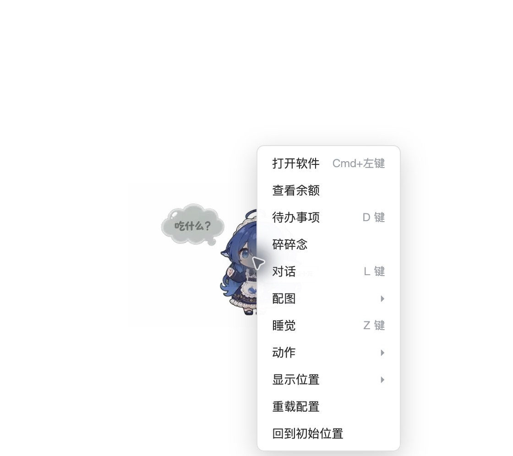
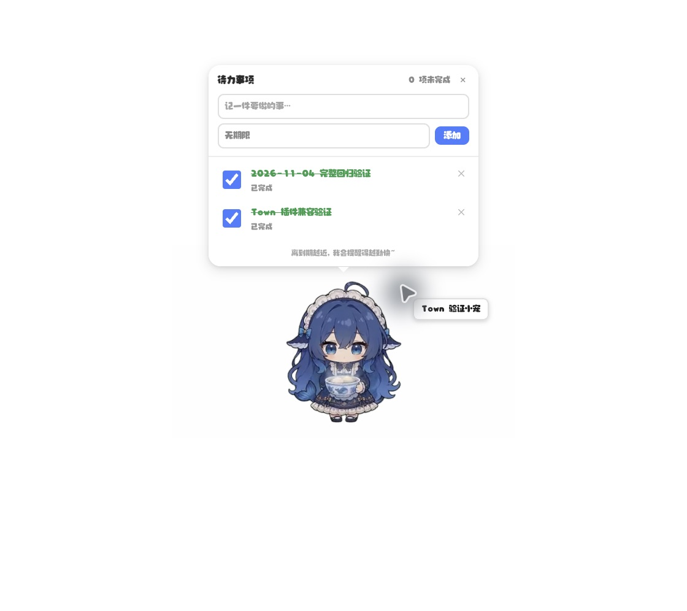
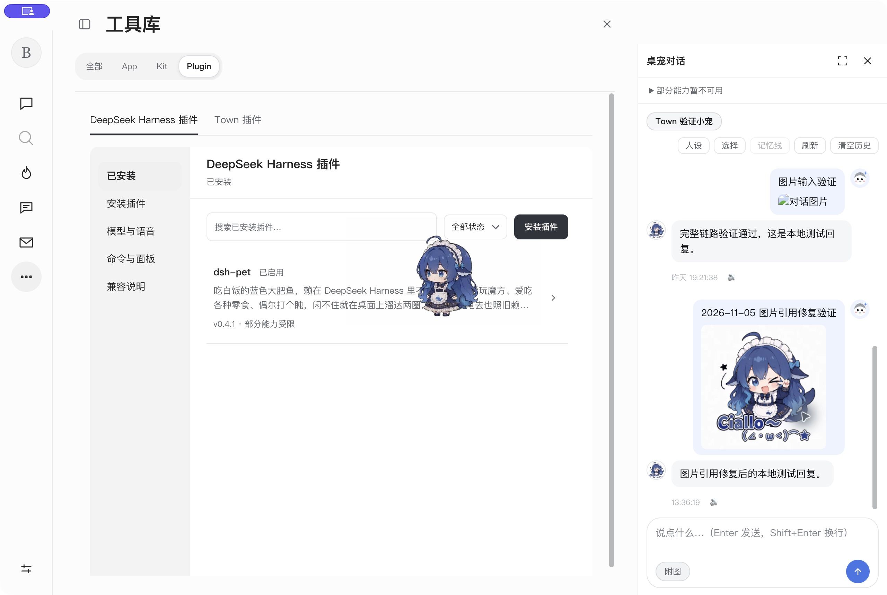

# DSH 插件原生补验（2026-11-05）

Mac 解锁后，首先通过 Harness UI 恢复此前停用的 `dsh-pet@0.4.1`，确认“运行中”，独立桌宠窗口与动画重新出现。随后在 Town 当前源码构建、独立测试 profile 中验证插件管理及原生窗口。**已补齐下列项目，仍不能认定全部行为与 Harness 等价。**

## 原生 computer use

使用原生应用 AX、截图和实际点击；Town 与 Harness 均加载未修改的原版插件。Town 的测试宠物为“Town 验证小宠”，Harness 原有宠物为“蓝毛小女仆”，两者没有共用宿主配置。

| 项目 | 观察结果 |
| --- | --- |
| Harness 恢复 | 包与组件均显示运行中；原版 Electron helper、动画及右键菜单可见。保留用户原有大小、位置及开关。 |
| Harness 设置基线 | 实际打开“设置 → 桌宠配置”，检查固定标题、左侧导航、原版配置卡片与独立滚动。未修改配置。 |
| Town 插件入口 | 从“更多功能 → 工具库 → Plugin”进入；DSH/Town 两类插件标签、已安装列表、详情与配置在 Kit 内显示，没有再次打开一层管理弹窗。 |
| Town 原版设置 | 插件详情直接显示原版配置；高级信息、管理和兼容说明折叠。原版控件可操作，保存反馈为“已保存，桌宠即时生效”。 |
| 两者都显示 | 客户端内有宠物；独立 helper 窗口也存在。 |
| 仅桌面 | 保存后客户端内宠物移除，独立窗口保留。 |
| 仅浏览器 | 保存后客户端内宠物恢复，独立窗口关闭；helper 托盘进程仍保留，此时没有该 helper 的 renderer 进程。 |
| 都不显示 | 保存后客户端内宠物移除，独立窗口继续隐藏。随后恢复“两者都显示”，两处重新出现。 |
| 原生操作菜单 | 两端菜单项目一致：打开软件、余额、待办、碎碎念、对话、配图、睡觉、动作、显示位置、重载、回到初始位置。没有把看到菜单当作每项功能通过。 |
| 待办持久化 | 新启动 Town 后，在独立窗口打开待办，昨日两条已完成测试记录仍在，未完成数量为 0。 |
| 历史和侧栏 | “命令与面板 → 桌宠对话”打开原版侧栏，昨日文字历史仍在；展开/还原保留未发送草稿，输入与发送按钮在可视范围。 |
| 图片发现与修复 | 旧测试历史图片显示失败，定位到通用附件 ID 契约错误；修复后通过原生文件选择器选取公开的插件 logo，发送到本机模拟模型，历史图片和回复均正常显示。 |

此次图片请求只发到 `127.0.0.1` 的临时 SSE 模型，没有使用真实账号或付费 API。测试后清空临时模型配置、关闭测试客户端和模拟服务、恢复原隔离 profile 的加密配置备份；桌宠显示模式恢复为测试前的“两者都显示”。Harness 桌宠保持启用。

## 本轮修复

Town 原先生成裸 64 位哈希作为附件 ID；Harness 的附件契约及原版 dsh-pet 的取图接口要求 `sha256:` 加 64 位小写十六进制字符，因此图片生成请求能成功，历史取图却会返回 400。

`attachments.saveImages` 现返回标准 ID，`imageHostPath` 校验引用并去掉前缀定位本地对象。SDK 类型和说明同步更新。修复发生在通用附件服务，没有修改 dsh-pet 源码、路由或私有历史。旧测试历史中不合规的裸哈希引用仍原样保留；新上传与冷启动后的标准引用均可读取。

测试流程同步修正：FontTune 安装后使用其原生关闭按钮收起默认悬浮面板，避免挡住下一次安装；主题测试等待新聊天 iframe 接收宿主配色，而非仅等待初始缓存已经满足的 `light` 标记；启动动画测试使用新版常驻“对话”导航，避免依赖旧管理页的返回按钮。

## 自动化

| 检查 | 结果 |
| --- | --- |
| 全量 Vitest | 159 文件通过、10 跳过；1350 项通过、33 跳过。 |
| TypeScript | 通过。 |
| 原版 dsh-pet host 集成 | 通过；新增图片取回状态、MIME、完整字节及冷启动后相同字节断言。保留原有配置、图片模型请求、失败恢复、待办、显示模式和语音协议测试。 |
| FontTune 0.7.6 + Pomodoro 0.5.5 + 通用插槽夹具，真实 Electron | 通过；安装共存、原版配置保存、嵌套插槽、校验/未保存提示、键盘焦点、番茄钟开始/暂停、多轮启停、故障插件恢复及 920×640 设置布局。 |
| dsh-vscode-themes2 1.1.0，真实 Electron | 通过；Dracula/GitHub Light、13/21px 阅读字号、主界面和聊天 iframe 配色、导航、重载、清除插件配色与重新启用。 |
| dsh-boot-suite 2.15.17，真实 Electron | 通过；全屏启动动画的交互与自然结束、模板编辑器、设置中的预览与跳过、壁纸配置、聊天 iframe 透明背景、停用/启用与卸载清理。 |
| DSH 生命周期 | 通过；包含新版列表筛选保留、设置入口去重、未保存模型表单、无关插件启停保留侧栏草稿、内嵌 slot context。 |

测试使用 mock keychain，不代表系统钥匙串授权已验收。首次复用早期 profile 时，其旧密文不能被当前 mock keychain 解密；测试前保留原密文备份，以空服务配置完成界面检查，结束后恢复备份。构建仍有既有大 chunk 提示。启动动画脚本包含未配对的聊天夹具及停用/重载场景，日志有 401、503 和资源取消提示；这里的“通过”指脚本明确覆盖的断言，不表示整份网络日志没有失败请求。

本轮日志位于 `/tmp/town-native-{community,theme,boot,pet-host,suite,lifecycle,types,model}-20261105.log`。`git diff --check` 通过。

## 仍未验收或不等价

- 独立窗口的创建、关闭、重新创建和交互已验证；原生窗口截图被工具裁切，透明区域显示为白底，不能据此确认桌面合成透明度、点击穿透、置顶层级、拖拽抛掷轨迹或多屏/DPI 行为。这些项目仍不计为通过。
- 托盘后台进程的保留已观察；托盘菜单、多宠碰撞、真实麦克风、屏幕截图、通知投递、TTS 与真实余额未在本轮实测。
- 原版 helper 的“打开软件”使用硬编码 `dsh://open`，仍可能唤起 Harness。没有抢占协议或按包名特判。
- 完整 Session/Agent/工具执行、Being 系统提示词桥接、可选 systemPrompt 限制提示、模型流 finish/usage 等既有缺口仍见[社区插件审查](dsh-community-review-2026-11-04.md)。Windows/Linux 未实机验收。

## 右键配图专项复查

针对“右键桌宠选择配图后没有内容”，再次通过 computer use 检查原版 dsh-pet 0.4.1。Harness 与 Town 的“配图 → 纳入对话的配图”均可展开，缩略图正常。Town 隔离 profile 未配置模型时，点击“吃白饭的大肥鱼”会收起菜单但不显示气泡；同一时刻 `data/dsh-pet/logs.txt` 记录 `reason=provider-missing 当前对话未配置模型`。

原版菜单的语义是“用这张图生成一句话”，调用 `/whisper?pet=main&surface=desktop&image=...`。插件在生成成功后才写入 `pets.main.say`；失败时只记日志，刻意不弹错误气泡。模型缺失、API 失败都可能表现为“点击后没有反应”，不能仅凭这个现象断定图片接口故障。

在相同隔离 profile 的“工具库 → Plugin → DeepSeek Harness 插件 → 模型与语音”配置本机模拟 SSE 模型后，再选择同一张图片，图片及“配图选择成功，开饭啦！”文字气泡正常显示。未调用真实付费模型，未修改原版插件。测试结束清除模拟配置、退出测试客户端并恢复原加密配置备份。此结果证明该操作链路可用，不代表已经检查用户日常 profile 的模型配置。

`tests/dsh-pet-host.mjs` 新增原版插件回归：无模型返回 `provider-missing` 且不写气泡；配置后选中的图名进入模型提示词，成功响应与轮询状态包含同一图名和文字；实际图片返回 PNG；HTTP 503 返回 `generate-error` 且不覆盖已有气泡。集成测试通过，日志 `/tmp/town-meme-host-20261105.log`。

## 截图

Harness 原版设置：

Town Kit 内嵌原版设置：

原生桌宠菜单与重启后待办：

修复后新上传图片正常显示；上方保留的旧测试记录使用不合规裸哈希，未改写插件私有历史：

