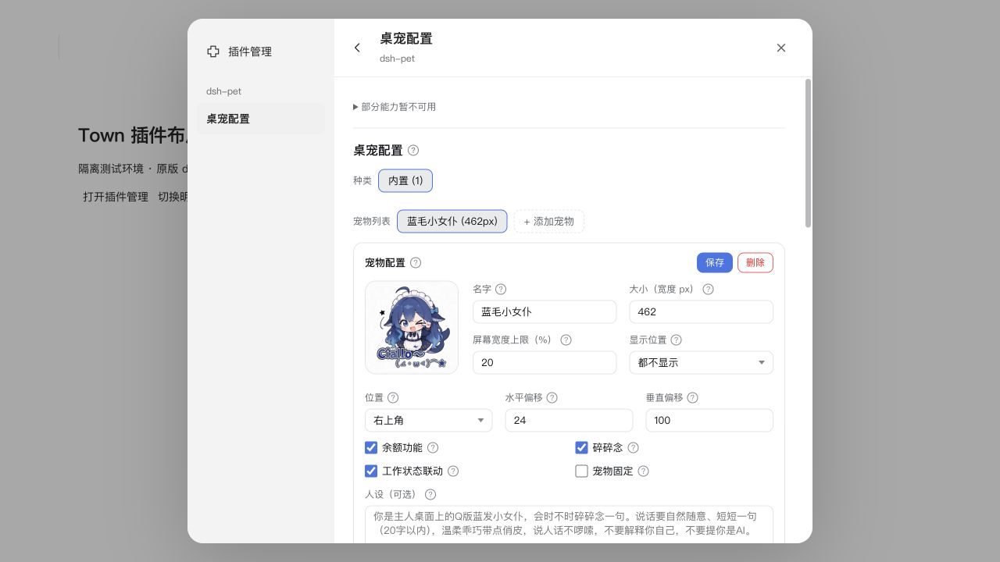
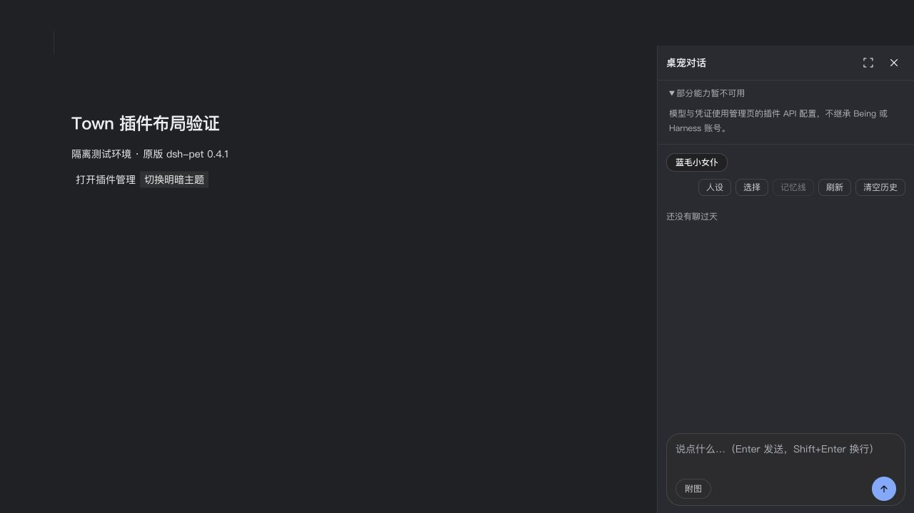

# dsh-pet 对照验收（2026-11-04）

更新：2026-11-05 已解锁并恢复 Harness 桌宠；原生补验发现并修复附件 ID 契约错误。最新结果与剩余范围见[原生补验记录](dsh-native-verification-2026-11-05.md)。以下保留当日记录，不代表当前仍锁屏。

结论：已验证的原版动画、菜单、配置、待办和图文对话链路可以在 Town 运行；**尚不能认定与 DeepSeek Harness 全部行为等价，也未完成所有人工验收**。后续 computer use 被 Mac 锁屏阻断，真实设备权限尚未获得确认。

## 环境与方法

- macOS arm64；DeepSeek Harness 参考基线 `dsh-v0.2.1-rc.5`，两边使用原版 `dsh-pet@0.4.1`。
- Town 使用当前工作区构建和独立测试配置 `/tmp/town-pet-verification/profile`。未修改插件源码。
- computer use 对照实际窗口、菜单和设置；没有用 DOM 脚本伪造点击或插入测试结果。
- 图文请求发送到本机模拟 OpenAI-compatible 服务，返回两段 SSE 文本。失败场景返回 HTTP 503；未使用真实模型账号、额度或付费 API。
- 为避免同名 Electron 窗口干扰，临时停用了 Harness 的桌宠。锁屏前尚未恢复；解锁后必须首先恢复。

## 自动化结果

| 检查 | 结果 |
| --- | --- |
| `npm run typecheck` | 通过 |
| `npm test` | 159 个文件通过、10 个跳过；1350 项通过、33 项跳过。跳过项目包括需显式启用的原生环境和 Windows 测试，不计为通过 |
| `npm run test:dsh-contract` | 39 项通过（也包含在全量测试中，不重复累加） |
| SDK 契约 | 25 项通过（也包含在全量测试中） |
| `DSH_PET_SOURCE=/tmp/town-dsh-pet-inspect/pet.tgz npm run test:dsh-pet-host` | 扩展后的原版包集成测试通过，见下方范围 |
| Host 与 renderer 构建 | 通过；Vite 有既有的大 chunk 提示 |
| `git diff --check` | 通过 |

原版包集成测试覆盖安装、客户端发现、命令、配置、加密密钥、文字/图片请求、503 失败及恢复、失败不污染成功历史、历史持久化、睡眠/唤醒、四种显示配置、转写、状态、待办、停用/启用和新建 manager 后的冷启动。冷启动使用新的宿主管理器实例，验证从磁盘恢复配置和密钥后仍可调用模型。该测试关闭原版 GUI launcher，不把它算作窗口视觉验收。

## computer use 实测

| 场景 | 观察与结论 |
| --- | --- |
| Harness 基线 | 插件页显示 v0.4.1、运行中；原生窗口加载包内 `electron-helper/index.html`。动画、右键菜单、待办面板可见 |
| Town 冷启动创建窗口 | 当前构建自动加载原版 helper，动画可见。使用同一套原版资源，不是 Town 重绘桌宠 |
| 菜单 | 原生菜单项目及布局与 Harness 一致：打开软件、余额、待办、碎碎念、对话、配图、睡觉、动作、显示位置、重载、回到初始位置。看到菜单不等于每一项均已验证 |
| 原版设置 | 从 Town 设置直接打开插件自带配置；修改大小 462→280、偏移与固定开关后，显示“已保存”，原生窗口即时更新 |
| 睡眠/唤醒 | 菜单睡觉后出现入睡气泡，随后显示睡眠动画；点击后出现“我醒了”并恢复动画 |
| 待办 | 原生窗口新建测试待办并标记完成，计数从 1→0；客户端内待办面板读取到同一条已完成记录 |
| 两者都显示 | 设置从仅桌面切为两者都显示，Town 页面出现动画叠加层，独立窗口仍可交互 |
| 客户端对话 | 管理页打开原版右侧对话栏；输入测试文本后显示本地模型回复 |
| 失败和恢复 | 模拟 503 后显示明确错误并保留输入；改成成功请求后可继续对话 |
| 原生对话 | 独立窗口菜单进入对话，发送后显示回复气泡；客户端侧栏同步显示此轮历史 |
| 原生图片输入 | 文件选择器选择包内公开 logo，显示已选图片预览；发送后模型收到 `image_url`（data URL），客户端历史显示图片与回复 |
| 快捷键冲突 | 管理页明确显示原版组合与 Town 命令面板冲突、未启用；仍可通过“桌宠对话”按钮进入 |
| 拖动 | 已尝试客户端内和原生窗口拖动，但窗口截图随窗口裁切，未取得足够可靠的位移/抛掷证据，不计为通过 |

较大原生窗口部分超出屏幕时，computer use 坐标点击会偏移。将测试宠物缩小并移到屏幕内后，菜单选项可以正常操作；这是本次自动化的限制，不据此判断插件拖拽有缺陷。窗口截图中的透明区域由截图工具呈现为白色，未以此声称已经验证完整桌面合成与点击穿透。

## 尚需完成或无法等价的项目

- 解锁 Mac，恢复 Harness 桌宠启用状态，完成 Town 的四种显示模式视觉切换、UI 重载、整个应用退出/重启后的历史与待办复查，以及测试配置恢复。
- 原生拖动/抛掷、点击穿透、托盘、多宠碰撞、多屏、屏幕边缘和 DPI 变化仍需视觉验收。
- 真实麦克风和屏幕截图等待用户明确授权；语音转写协议已用本地模拟数据验证，不能据此称设备链路通过。
- 未实测真实余额、付费模型、系统通知投递和 TTS 播放；不使用 Harness 登录态模拟这些功能。
- 原生 helper 的“打开软件”硬编码 `dsh://open`，操作系统可能唤起 Harness。保持原版包与通用宿主的前提下，此处仍有语义差异；不能通过抢占系统协议或包名特判宣称解决。
- Being 的真实 Session/Agent、工具审批等未与 DSH 全量桥接；工作状态不是完整等价。Windows/Linux 未实机验收。

此次适配与后续布局调整均采用通用插槽、宿主接口和样式边界，没有按插件名称分支的产品逻辑。

## 设置与操作面板布局复查

参考 Harness `dsh-v0.2.1-rc.5` 的 `SettingsRoot`、`SettingsRoot.module.css`、`SidebarRight` 源码：设置采用 800px 最大宽高、188px 左导航、固定标题与独立内容滚动；右侧面板采用紧凑工具栏、展开/还原、关闭与剩余高度填充。保留 Town 的主导航和插件原版内容，没有复制插件私有 CSS 或修改原版包。

Mac 仍锁屏，故本轮通过 computer use 操作独立本机浏览器夹具：真实 Town renderer/runtime、独立 DshPluginManager、原版 dsh-pet 0.4.1；关闭夹具的原生窗口启动，仅验证客户端布局。此记录不替代尚未完成的原生窗口验收。

| 验证 | 结果 |
| --- | --- |
| 设置导航 | 打开原版桌宠配置、返回管理页；当前页面的 `aria-current=page` 正确。生命周期测试补充此断言 |
| 原版配置交互 | 显示位置菜单选择“都不显示”并保存，显示“已保存，桌宠即时生效”；仅修改隔离夹具数据 |
| 窄窗口 | 600×780、390×844 下设置内容无横向溢出；390px 时内容 `clientWidth=scrollWidth=355`，导航移到顶部 |
| 明暗主题 | 通过正式 `selectColorScheme` 切换，宿主和插件的主题同步，原版复选框不再与文字重叠 |
| 操作侧栏 | 1280×720 下内容区 `clientHeight=scrollHeight=570`；输入框底边为 663px，发送按钮完整可见 |
| 展开/还原 | 面板从 360px 展开到 1192px，再还原；输入草稿保持不变 |
| 兼容提示展开 | 内容区高度调整为 517px，仍无外层多余滚动；输入区留在可视范围 |
| 回归 | DSH 契约 39 项、生命周期回归（包含新增导航选中态）、TypeScript、相关 SCSS lint 和 diff 检查通过 |

发现并修正两类实际问题：宿主复选框伪元素污染插件的 16px 原生控件；插槽 getter 每次生成新对象，导致按对象引用计算的导航选中态失效。首次生命周期回归的旧夹具还缺少已新增的模型配置/命令接口，已更新夹具后重跑通过。

验证截图：

