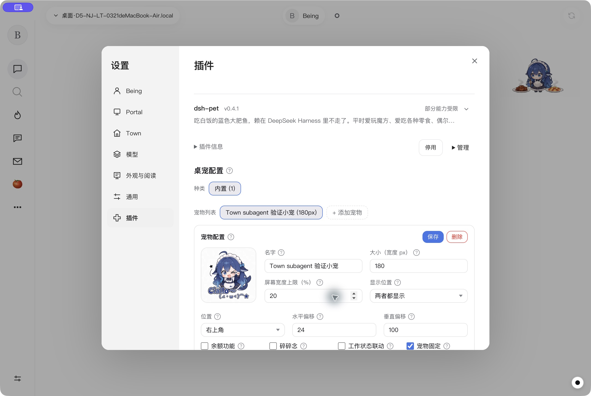
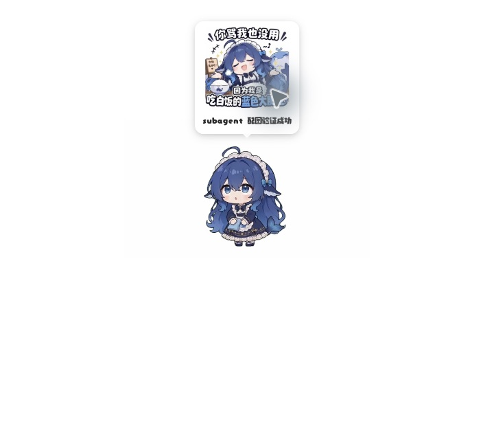

# 插件设置与模型复用验证

2026-11-05。此记录替代早期 Kit 详情页及独立模型表单的方案。

## 最终行为

- 插件设置保留在客户端「设置 → 插件」。官方插件标签排在最前；DeepSeek Harness 插件的原版设置进入同一窗口内的二级页面，返回列表保留搜索与滚动位置。Kit 的配置入口定位到同一设置分类。
- 保留设置分类导航、搜索和状态筛选；自动生成配置的未保存提醒覆盖关闭、切换分类和切换插件。设置框使用背景 inert 和焦点约束，不进入 Chromium 原生模态顶层，使原版挂在 document.body 的预览与编辑器仍能显示并交互。官方插件页面、侧栏与 DSH 面板从设置打开时先经过草稿检查并关闭设置。
- 删除独立的 DeepSeek 模型与语音设置页。先读取 Being 当前模型并检查接口；当前 Being 只有主对话流，没有独立插件生成接口，所以回退到现有 subagent 配置，不向 Being 主会话写入插件消息。
- subagent 适配 OpenAI Chat Completions 兼容协议。Anthropic Messages、OpenAI Responses、Google Generative AI、OAuth、工具调用和语音转写仍明确提示未适配。模型协议可用不等于远端认证、视觉能力或服务可用性已验证。
- 凭证只在本机宿主间使用，不回传界面。不再读取、改写历史插件专用 `services.enc`。

## 已完成验证

- 类型检查通过；DSH 契约测试通过。新增测试覆盖现有配置路径、环境凭证、禁用与缺失、协议不适配、配置变更、Being 查询优先级及双重失败原因。
- 原版 dsh-pet 0.4.1 宿主集成通过：配图、文字/图片生成、附件冷启动恢复、失败恢复、历史、待办、显示模式、启停和配置持久化。另验证 subagent 配置复用、运行中停用后的错误提示及旧凭证文件不被改写。语音转写保留明确报错的兼容占位，删除无法从桌面配置到达的转写 HTTP 分支。
- Electron 社区测试覆盖 dsh-fonttune 0.7.6、dsh-pomodoro 0.5.5、dsh-pet 0.4.1：原版设置保存、原地配置、键盘焦点、自动表单未保存提醒、920×640 布局、宿主启停和插件故障恢复。
- Computer use：独立隔离客户端中的「设置 → 插件」保留左侧设置导航；打开桌宠原版配置，名称、大小、位置、开关和保存按钮均在设置页内。
- Computer use：原版桌宠独立透明窗口右键「配图 → 吃白饭的大肥鱼」，通过 subagent 本地 SSE 测试接口返回文字，界面显示所选图片与“subagent 配图验证成功”。动态菜单需要连续操作；首次坐标点击未触发请求，不计为通过，最终使用原生可访问性元素完成。

测试使用隔离 profile 和本地模型接口，没有向真实付费模型发送验证请求。当前 Being 独立生成接口仍缺失，不能宣称已接通。macOS 原生窗口已验证；其他操作系统、真实模型视觉能力及系统麦克风不在本次通过范围内。

## 截图

